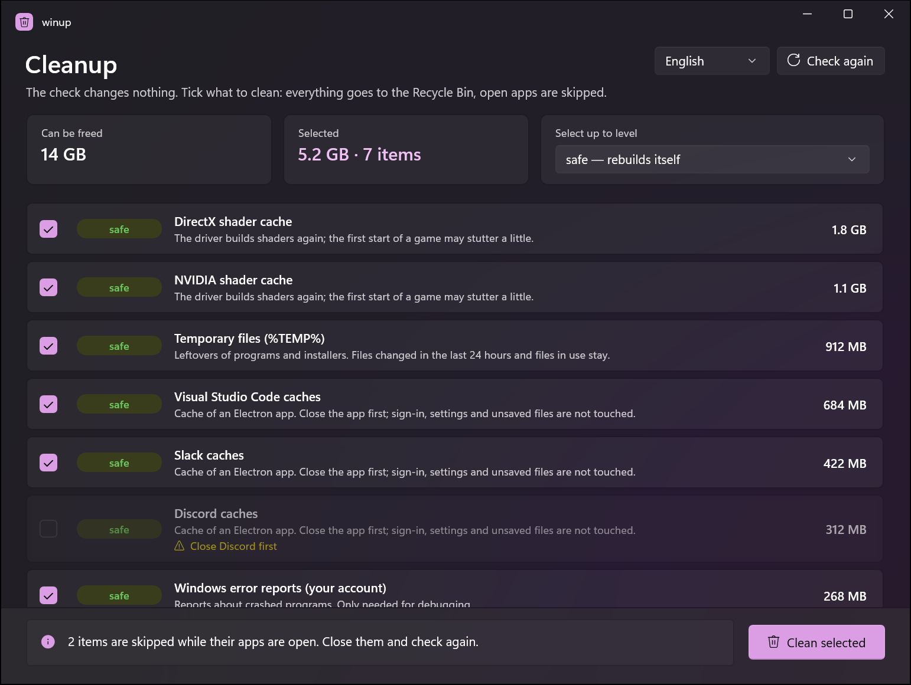
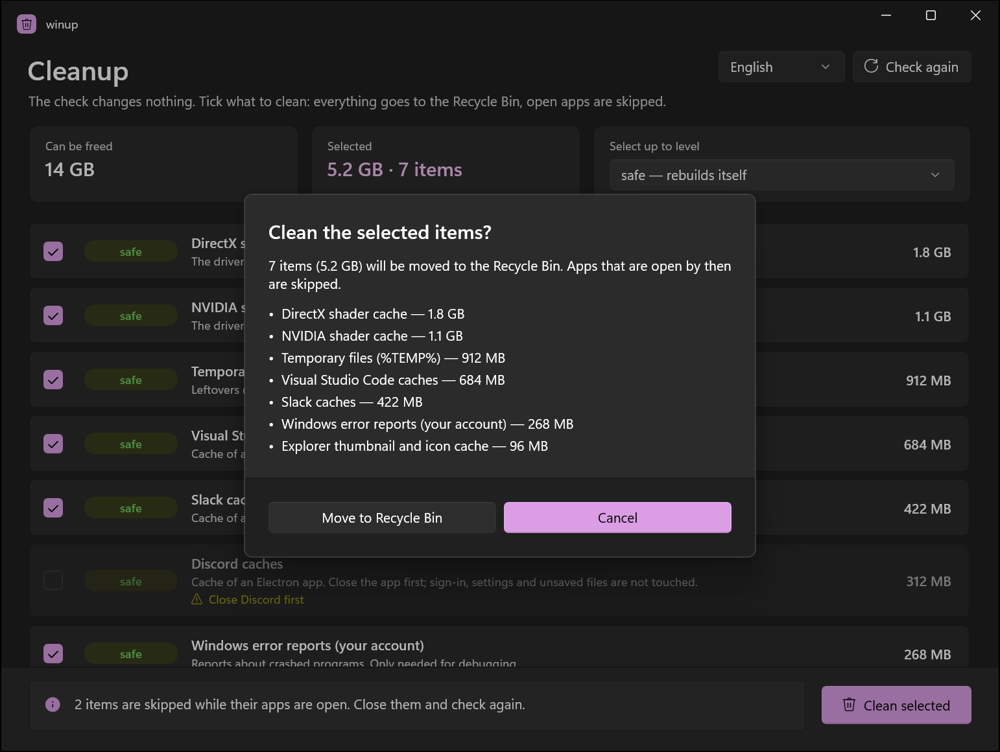
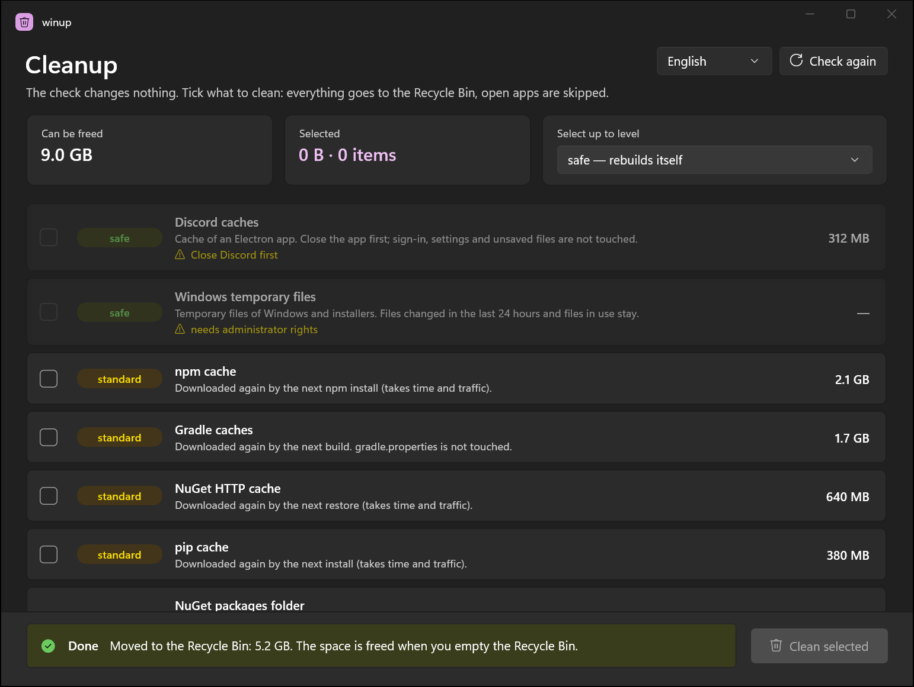
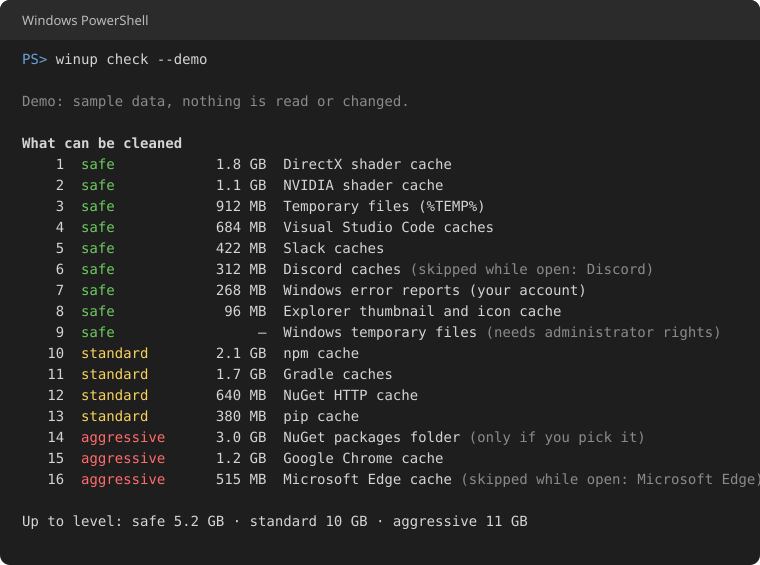
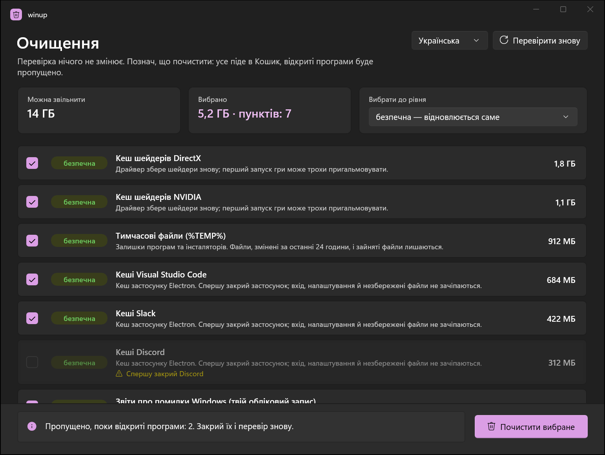

<div align="center">

# winup

**Free up space on Windows, safely.**
winup finds caches and leftovers that are safe to remove, shows how much each one takes,
and moves only what you tick to the Recycle Bin.


<picture>
  <source media="(prefers-color-scheme: light)" srcset="docs/images/app-light.png">
  
</picture>

</div>

> **Early version (0.1).** Cleaning caches works. Health checks, updates and system cleanups that need administrator
> rights are on the [roadmap](docs/ROADMAP.md).

## How it works

| 1. Check | 2. Pick | 3. Clean |
|:---:|:---:|:---:|
|  |  |  |
| winup looks around. **Nothing is changed.** | Tick items, or choose a level. You see the list once more before anything happens. | Everything goes to the **Recycle Bin**, so you can restore it. |

## Three levels

| Level | What it means | Examples |
|---|---|---|
| 🟢 **safe** | Rebuilds itself; you won't notice. | Temp files, shader caches, crash reports, app caches |
| 🟡 **standard** | Downloaded again when needed (time and traffic). | npm, pip, NuGet, Gradle caches |
| 🔴 **aggressive** | Sites and apps are slower for a moment. | Browser caches (never passwords, history or cookies) |

Some big items, such as all NuGet packages, are listed but only cleaned when you tick them yourself.

## What it finds

- **Windows:** temporary files older than 24 hours, Explorer thumbnails, crash dumps and error reports.
- **Graphics:** DirectX, NVIDIA, AMD and Intel shader caches; old NVIDIA driver downloads.
- **Apps:** caches of VS Code, Cursor, Slack, Discord, Teams, Telegram and other Electron apps, and of any other
  Chromium-based app, found by how its folder looks.
- **Games:** Steam, Epic Games, Battle.net and EA app caches. Games and saves are not touched.
- **Developer tools:** npm, Yarn, pip, uv, NuGet, Go, Gradle, Cargo, Maven, Playwright.
- **Browsers:** Chrome, Edge, Brave, Vivaldi, Opera, Yandex Browser, Firefox (cache only).

## Safe by design

- **A check never changes anything.**
- **Recycle Bin, not delete.** Changed your mind? Restore it from the Recycle Bin.
- **Open apps are skipped.** winup checks which programs are running or hold the files open, and tells you what to close.
- **Only known cache folders.** Documents, Desktop, Downloads, Pictures, OneDrive, browser profiles, app settings,
  SSH keys and virtual disks (WSL, Docker, VMs) are never touched.
- **Every path is checked again** right before it moves, and shortcuts to other folders (links, junctions) are never followed.
- **No administrator rights.** winup runs as you.

## For the command line



```powershell
winup check                     # see what can be cleaned, then pick numbers or a level
winup clean --level standard    # clean up to a level (asks first)
winup check --demo              # try it with sample data; nothing is read or changed
```

More: `winup history`, `winup rules`, `--lang en|uk`, `--yes`. The app takes `--demo` too.

## Get it

There is no installer yet: the first release on GitHub Releases, then winget, is on the [roadmap](docs/ROADMAP.md).
Until then, build it from source with the [.NET 10 SDK](https://dotnet.microsoft.com/download): see [docs/DEVELOPMENT.md](docs/DEVELOPMENT.md).

## Languages

English and Ukrainian. winup follows your Windows language; you can switch it in the app or with `--lang`.

<p align="center"></p>

## License

[MIT](LICENSE)
