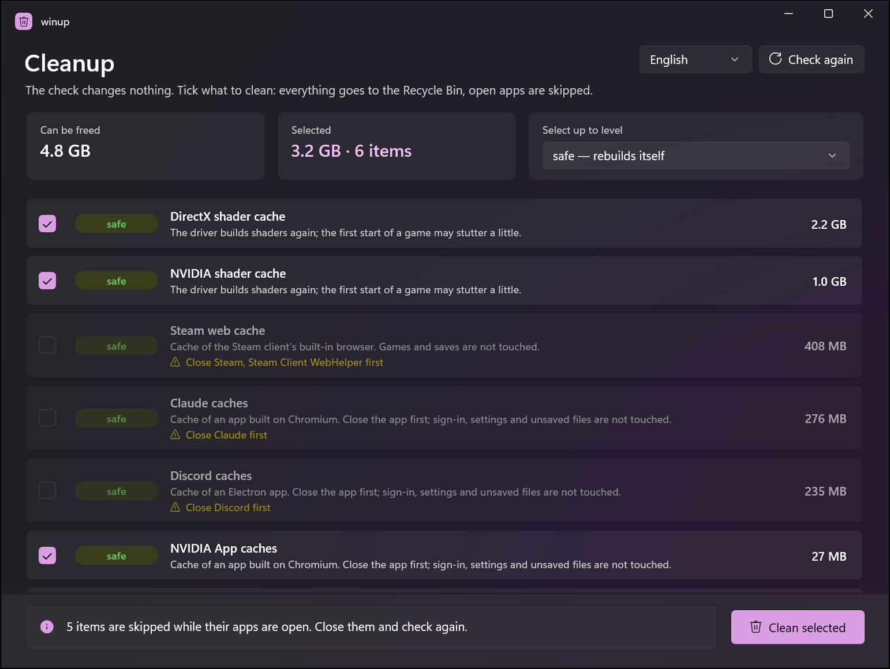

# winup

Clean and look after a Windows PC. The app comes first, with a command line for those who want it. Both use the same core.
winup is the Windows sibling of [macup](https://github.com/VitaliiDeveloper/macup).



<sub>Also in Ukrainian: [docs/images/app-uk.png](docs/images/app-uk.png)</sub>

> Status: early prototype (0.1). Cleanup of caches works; updates, health checks and admin-only cleanups come later.

## What it does

- **Check first, pick later.** A check changes nothing. It lists what can be cleaned, with sizes and levels; you tick what goes.
- **Three levels, as in macup:** 🟢 `safe` (rebuilds itself), 🟡 `standard` (downloaded again), 🔴 `aggressive` (browser caches; sites load slower at first).
- **Everything goes to the Recycle Bin.** You can restore it; the space is freed when you empty the bin.
- **Open apps are skipped.** By process name, and for apps found by folder layout, by asking Windows' Restart Manager which programs hold the files open.
- **Interface in English and Ukrainian** (follows Windows, or pick it in the app or with `--lang`).
- **Reports and history:** every cleanup writes a Markdown report and a line in `history.jsonl` under `%LOCALAPPDATA%\winup`.

What it cleans today: temporary files (older than 24 h), Explorer thumbnails, DirectX/NVIDIA/AMD/Intel shader caches, NVIDIA
driver downloads, crash dumps and error reports, caches of Electron apps (VS Code, Cursor, Slack, Discord, Claude, …) and of any
other Chromium-based app found by its folder layout, Steam/Epic/Battle.net/EA launcher caches, npm/Yarn/pip/uv/NuGet/Go/Gradle/
Cargo caches, and browser caches (Chrome, Edge, Brave, Vivaldi, Yandex, Opera, Firefox). NuGet packages, the Maven repository and
Playwright browsers are listed but only cleaned when you tick them. Run `winup rules` for the full table.

## Safety

- **Only listed cache folders.** Rules are data ([`rules.json`](src/Winup.Core/Data/rules.json)); a fixed list of allowed places
  in code ([`SafetyPolicy.cs`](src/Winup.Core/SafetyPolicy.cs)) has the last word, so a bad rule cannot reach anything else.
- **Two phases.** Every single path is checked again right before it is deleted: still inside its rule's folder and an allowed
  place, not protected, and no folder on the way is a link.
- **Links and junctions are never followed or removed.**
- **Never touched:** Documents, Desktop, Downloads, Pictures, OneDrive, browser profiles (passwords, history, cookies, bookmarks),
  Electron `User` and `Backups` folders, `.ssh` and other key folders, Store app packages, WSL, and virtual disks (`.vhdx` and
  friends) wherever they are.
- **No administrator rights by default.** System folders (Windows Temp, minidumps) are listed and marked; cleaning them with
  elevation for that action only comes in a later version.

## Usage

The app: run `winup-app.exe`. It checks on start; tick items or pick a level, then **Clean selected** and confirm.

The command line:

```powershell
winup check                     # list what can be cleaned (changes nothing), then pick numbers or a level
winup clean --level standard    # clean everything up to a level; asks first (--yes to skip the question)
winup history                   # past cleanups
winup rules                     # what winup knows how to clean
```

Options: `--level safe|standard|aggressive`, `--lang en|uk`, `--yes`, `--no-color`, `--no-pick`.

## Building

Windows 10 1904x or newer, [.NET 10 SDK](https://dotnet.microsoft.com/download). Visual Studio 2026 is optional (XAML designer,
Hot Reload); the command line is enough.

```powershell
dotnet build winup.slnx
dotnet test tests/Winup.Tests
dotnet run --project src/Winup.Cli -- check
dotnet run --project src/Winup.App
```

| Project | What it is |
|---|---|
| `src/Winup.Core` | Rules as data, scanner, safety policy, cleaner, Recycle Bin, reports, translations |
| `src/Winup.Cli` | `winup` command line |
| `src/Winup.App` | WinUI 3 app (Windows App SDK, unpackaged, self-contained) |
| `tests/Winup.Tests` | xUnit tests on throwaway fake folder trees; the real profile is never touched |

To support another cache, add a rule to `rules.json` and its label and note to `strings.json`. The tests fail if a rule points
outside the allowed places or a string has no Ukrainian translation.

## License

MIT
